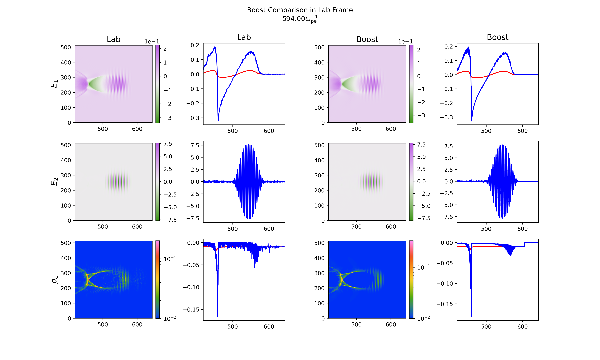

**Overview of Boosted Frame Simulations**

In a boosted frame LWFA simulation, one runs the simulation in a frame coving relativistically in the direction of laser propagation. In this frame, there are two major changes relative to the lab frame: first, the laser wavelength is redshifted by a factor of $\gamma(1+\beta)$, so the longitudinal resolution $dx_1$ and timestep $dt$ can be increased by a factor of $\gamma(1+\beta)$; and second, the plasma is Lorentz-contracted by a factor of $\gamma$, meaning that the light-crossing time is shorter in the boosted frame. So by running in this frame, there is theoretically a speedup proportional to $\gamma^2$ relative to the lab frame; in practice the maximum $\gamma$ is bounded by a factor proportional to $(\omega_0/omega_p)^2$. 


**Overview of Boosted Diagnostics**

This module implements boosted diagnostics, which reconstruct grid quantities in a different frame than the simulation frame as the simulation proceeds. The main application that I have in mind is for reconstruction of lab frame timeslices in a boosted LWFA simulation, but arbitrary frame reconstruction is possible. 

The fundamental problem of reporting data in a different frame is that because of the spatial dependence of time in a Lorentz transformation, time slices are not synchronous between frames. Thus the data required to reconstruct a slice of constant time in one frame within a simulation frame requires data that lies along a tilted parallelogram in spacetime. For a 2D simulation, the data required for reconstruction lies along a transverse slice moving with a constant velocity throughout the simulation. However, the slice does not overlap either simulation grid points nor timesteps. Thus, interpolation onto this moving slice is required in both space and time. One must then buffer this data and ultimately write it to disk, which is not an easy task because each node will be responsible for different slices to reconstruct over the course of the simulation. 

These diagnostics are essential for assessing the validity of boosted LWFA simulations because the same physics can appear significantly different than when running in the lab frame (although regular diagnostics from the simulation in the boosted frame are also an important source of information. Moreover, these diagnostics enable direct comparison of boosted simulations to lab-frame simulations of the same problem, which is otherwise not possible without dumping data at every timestep for postprocessing. 

Here is an example showing a lab frame LWFA simulation on the left compared to a boosted frame simulation on the right with boosted diagnostics used to extract lab time slices. Differences other than fine-scale resolution on the order of individual cell (affected by the interpolation scheme) are due to actual differences between these two simulations, not the boosted diagnostics. 



**Other Applications** 

There are also other scenarios where boosting may be beneficial. Two examples I can immediately think of are a relativistic shock simulated in the shock frame or a relativistic jet in its comoving frame. Boosted diagnostics may be insightful in these cases, for example if theoretical calculations are easier to carry out in the lab frame. 

Another potentially useful application would be to forward-boost the data from a lab-frame LWFA simulation. This could be used to directly assess the quality of a given boosted frame simulation if the lab-frame simulation is trusted. 

Another useful feature made possible by this diagnostic is reporting of subsets of simulation data without boosting. For example, one can use a boosted diagnostic with gamma=1 to extract a high-resolution subvolume moving at arbitrary velocity. At present this would only work for subvolumes with full transverse dimensions, i.e. only a reduction in longitudinal spacing is possible; implementation of subvolume tracking with arbitrary transverse sizes would be possible using this framework. 


**Lower-level overview (code details)** 

All of the work is handled by two classes: the `t_boosted_diag` and `t_boosted_grid_manager`  classes. These are in `os-boosted-diag.f03` and `os-boosted-grid-mgr.f03`, both in the new subfolder `source/boost/`. The `t_boosted_grid_mgr` is responsible for handling coordinate conversions between the two frames and nothing more. Each `t_boosted_diag` stores a pointer to a `t_boosted_grid_mgr` which informs which computations must be done at each timestep; the `t_boosted_diag` then does these computations and writes data at specified intervals. The grid manager will work with any gamma, and this can be specified in the input deck.

Important to point out is that the interpolation used is not consisent with the field solver used in the code. This would be a problem if the boosted diagnostics were coupled to the simulation, but since they're just diagnostics, there shouldn't be too much of a difference from the "true" simulation quantities (with quotes because these quantities are not actually attained in the simulation). With that said, this may be problematic for applications in which true values of the simulation fields are important, e.g. scenarios where the data must satisfy fluid equations to machine precision. In such a case a consistent interpolation could be implemented. 


**Namelist structure**

Here is an example of how to use boosted diagnostics in an input deck: 
```
diag_emf
{
    ndump_fac = 1,
    ndump_fac_ave = 0,
    ndump_fac_lineout = 0,
    reports = "e1", "e2",
}

boosted_diag
{
    ndump_fac = 1,  
    boost_tmin = 0.,
    boost_tmax = 1000., 
    boost_dt = 49.5, 
    boost_xmin = -175.,
    boost_xmax = 50., 
    boost_nx = 125,
    boost_if_move = .true.,
    boost_move_vel = 1.,
    boosted_reports = "e1_boost", "e2_boost", 
}

... 


diag_species
{
    ndump_fac = 1,
    ndump_fac_pha = 1,
    reports = "charge_cyl_m",  
    phasespaces = "p1x1",
}

boosted_diag
{
    ndump_fac = 1, 
    boost_tmin = 0.,
    boost_tmax = 1000., 
    boost_dt = 49.5, 
    boost_xmin = -175.,
    boost_xmax = 50., 
    boost_nx = 125,
    boost_if_move = .true.,
    boost_move_vel = 1.,
    boosted_reports = "charge_boost_cyl_m", "j1_boost", 
}
```

Here is a description of the parameters: 
* 'ndump_fac': How often to report boosted diags. The total dump frequency is this times the global simulation `ndump_fac`. 
* `boost_tmin`, `boost_tmax`, `boost_dt`: the minimum and maximum times which will be reconstructed, and the amount of time between reconstructed time slices 
* `boost_xmin`, `boost_xmax`, `boost_dx`: longitudinal space parameters of the reconstructed time slices at $t=0$ in the reconstructed frame. Transverse spatial parameters are currently assumed to be the same.
* `boost_if_move`: whether or not the reconstructed frame will use a moving window. Note that `boost_if_move` may be `.true.` independently of whether the simulation frame uses a moving window. 
* `boost_move_vel`: velocity of the moving window in the reconstructed frame; does not necessarily have to be 1, although this would be the most common choice. 
* `boosted_reports`: current options are:
    - Cartesian fields: `e1_boost`, `e2_boost`, `e3_boost`, `b1_boost`, `b2_boost`, `b3_boost`
    - Quasi-3D fields: `e1_boost_cyl_m`, `e2_boost_cyl_m`, `e3_boost_cyl_m`, `b1_boost_cyl_m`, `b2_boost_cyl_m`, `b3_boost_cyl_m`
    - Cartesian species: `charge_boost`, `j1_boost`, `j2_boost`, `j3_boost`
    - Cartesian species: `charge_boost_cyl_m`, `j1_boost_cyl_m`, `j2_boost_cyl_m`, `j3_boost_cyl_m`

There is an additional namelist parameter not used here called `signed_gamma`. This allows you to specify the signed gamma of the boost that will be applied to the simulation data to generate boosted diagnostics (negative for a boosted LWFA simulation). 

Right now only one boosted diagnostic (e.g. one gamma, one spatial domain) works for fields and for each species. This could easily be extended to permit more diagnostics by creating a linked list of boosted diagnostics, in the same way that we have a linked list of `t_vdf_report` objects. 


**Load-balancing issues**

The issue of load-balancing can be understood from the "moving slice" picture described in the overview section. Because the slices are moving through different domains, different domains will be responsible for different execution at different times. They will also generally have different amounts of data buffered when the simulation goes to dump the data. 

I have made no attempt to implement any sort of load balancing in this implementation. However, the overall cost of these diagnostics should be low enough that this is not an issue. 


**Quasi-3D and other simulation modes**

These diagnostics work in quasi-3D using the same input deck namelist, except the reports are called e.g. `e1_boost_cyl_m`, `charge_boost_cyl_m`, etc. Getting this into the code with minimal hackery was a bit of a challenge, but by discussing the issue with Ricardo and Kyle we've managed to achieve this. The idea is that there's a new class `t_boosted_diag_cyl_modes` which is a subclass of `t_boosted_diag`. This class functions similarly to how `t_cyl_modes` does for `t_vdf`: it wraps lists of boosted diags for real and imaginary parts of a given grid quantity. However, it's different because it's a subclass. This allows the parent species and t_emf initialization functions to use the same code to allocate / initialize the boosted diags, except when running in quasi-3d the overridden subclass routines will be called for this purpose. There is some nontrivial coding (not just wrapping superclass function calls) that needs to happen within the `t_boosted_diag_cyl_modes` to make this work, feel free to check out the code if you're interested. 

For other simulation modes, these diagnostics should work out of the box, with the exception of tiles.


**Potential future updates**

Something that may be important to look into in the future is the effect of the interpolation I'm using. I've implemented a bilinear interpolation in space and time. In principle, the combination of the field solver stencil in both space and time can be used to find the actual boosted simulation field at any given point in spacetime without doing this contrived interpolation. This would certainly increase resolution, but I'm not sure if the improvement would be significant. This would also likely require significantly more computational cost and complexity of code. 

Boosted phasespaces would be useful and should be possible to implement without significant modification of the code written here. This would be a bit expensive, though. A better way to get boosted phasespaces would be to implement boosted raw particle diagnostics (i.e arrays of position, momenta at a fixed time) using much of the same ideas, and then use these raw diagnostics to compute arbitrary phasespaces. 

Performance from the standpoint of both memory and numerical efficiency can certainly be improved. The way that I am doing interpolation in spacetime is likely not the most efficient from a numerical standpoint, given that I never benchmarked or attempted to optimize it. Another issue is that I'm buffering the whole previous Lorentz-tensor (either the full E,B or full 4-current) for the entire domain in the previous simulation timestep. This increases the grid data requirements by a factor of \~2. However, this is not necessary since only a small subset of the previous slice is actually used in computation. Additionally, it isn't necessary to buffer quantities which aren't used in computations, which is currently done for no reason other than simplicity of implementation. By the way, this problem effects memory more than cost for the fields, since copying should be cheap. For particles, this is a heavy cost, but I'm not sure of a way around it aside from implementing boosted raw particle diagnostics and using those to compute fluid quantities. 

Terms from higher order Lorentz tensors constructed from fields (including with derivatives, e.g. components of the rank-(2,0) tensor $ M^{\nu \beta } \equiv \partial_mu \partial_\alpha F^{\mu\nu} F^{\alpha\beta}$ ) could also be implemented, but this has not been necessary for our work so far. Higher order species moments using the same approach could also be implemented, but these would be more expensive.

